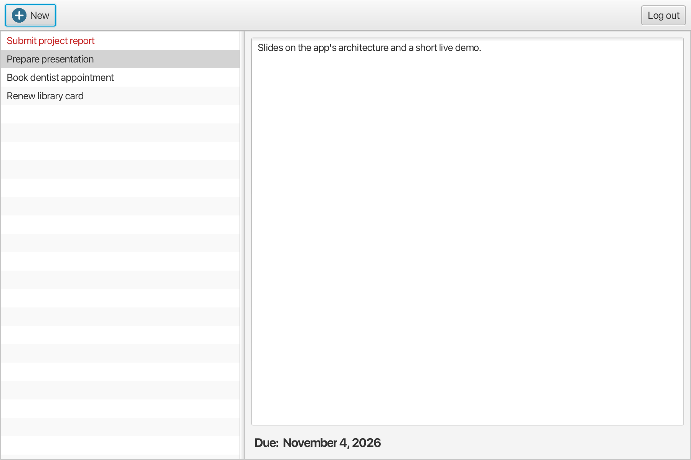
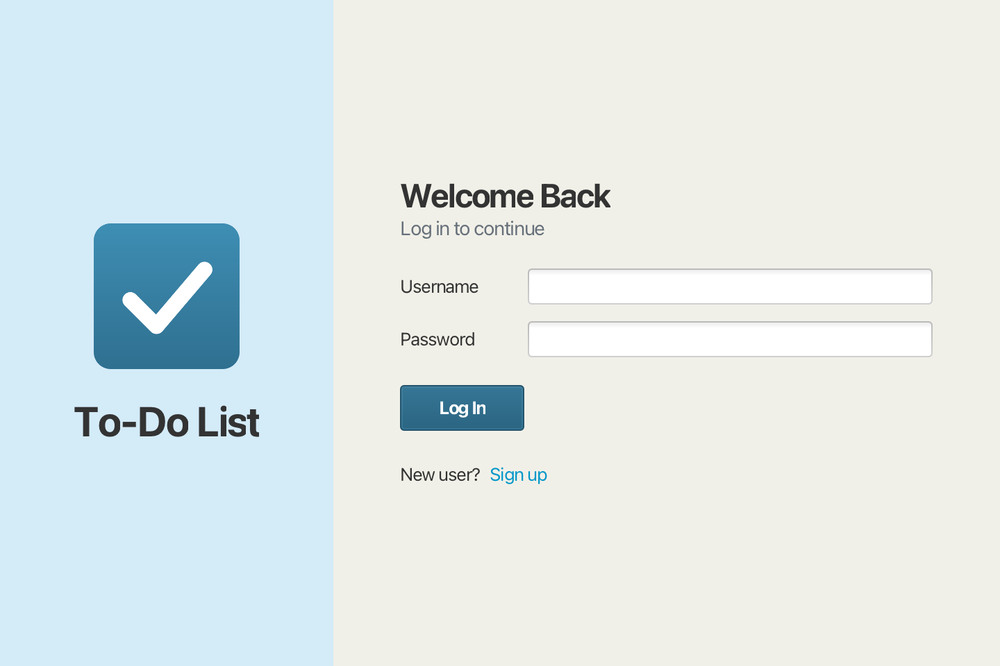
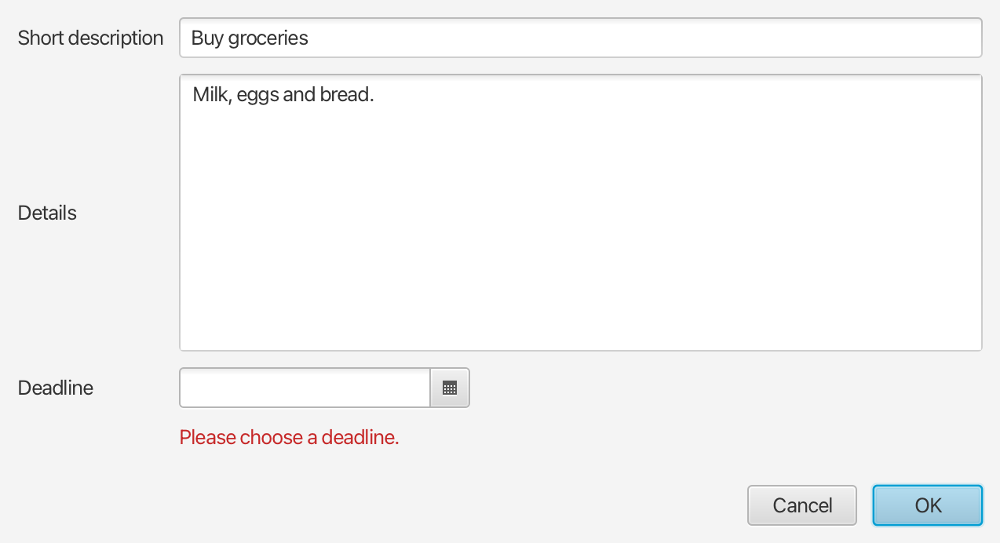

# To-Do List

A desktop task manager built with JavaFX and SQLite. Each user has their own account and their own tasks, stored in a local database that is created automatically on first launch.



| Log in | Add or edit a task |
|---|---|
|  |  |

## Features

- Sign up and log in, with each user's tasks kept separate
- Add, edit and delete tasks with a title, details and a deadline
- Tasks sorted by deadline, with those due today or earlier shown in red
- Input validation in the task dialog, and delete confirmation
- Keyboard shortcuts: Delete or Backspace removes the selected task
- Resizable layout

## Running the app

You need [JDK 25](https://adoptium.net/) or newer. Maven is included through the wrapper.

```
./mvnw javafx:run
```

On Windows, use `mvnw.cmd javafx:run`.

Data is stored in `~/.todolist-javafx/todolist.db`. To use a different file, run the app with `-Dtodolist.db=/path/to/file.db`.

## Running the tests

```
./mvnw test
```

The tests cover password hashing, login, data separation between users and saving tasks. Each test uses its own temporary database.

## Project structure

```
io.github.ngtdat9.todolist
├── TodoApplication   Starts the app and prepares the database
├── ui                FXML controllers and screen navigation
├── model             Tasks, users, validation and the logged-in user's task list
├── auth              Sign-up, login and password hashing
└── storage           SQLite connection, schema and all SQL
```

Controllers never contain SQL. All database access goes through `TodoRepository` and `UserRepository`, so the rest of the app doesn't depend on which database is used.

## Design decisions

- **SQLite instead of a database server.** A desktop app for local use shouldn't need a server, and anyone can run this one without any setup. The trade-off is that the data stays on one computer.
- **Salted PBKDF2 password hashes.** Passwords are never stored. Hashing uses PBKDF2-HMAC-SHA256 with 600,000 iterations from the JDK, so it needs no extra library. The iteration count is saved with each hash, so it can be raised later without breaking existing accounts.
- **Queries scoped by user.** Every task query includes the user's ID, so one user can't read or change another user's tasks, even with a valid task ID.
- **Save first, then update the screen.** Each change is written to the database before the on-screen list changes, so a failed save can't show data that wasn't stored.

## Known limitations

- Login separates users inside the app, but the database file isn't encrypted. Anyone with access to the file can read the tasks.
- Database calls and password hashing run on the JavaFX UI thread. That's acceptable for a small local database, but it can cause a brief pause at login.
- There is no way to mark a task as done or to search yet. These are the next features planned.
